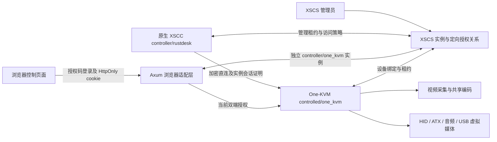

# XSCC KVM 架构

## 实例模型

One-KVM 作为 XSCC 仓库内的裸机 Web 宿主模块，可同时承载多个独立被控实例。每个实例是 XSCC 的一种被控实现，`backend=one_kvm`、`role=controlled`。它将真实 HDMI/视频采集、硬件编码、HID 和其他设备能力接入 XSCC 授权链路。浏览器和原生 XSCC 是两种控制入口。

浏览器控制端和 KVM 设备分别占用 XSCS 实例；浏览器授权码不能替代设备授权码。原生 XSCC 保持自己的 RustDesk 引擎实例，跨 backend 的访问由显式 ACL 决定。实例身份使用 manager/device/installation 与 credential epoch，不依赖显示名称或旧的 RustDesk 本地密码。

每个实例有独立被控身份与授权的 `ManagedKvm`、配置数据库、采集/编码/HID/音频运行时和原生监听端口。默认实例沿用原数据目录，新增实例保存在 `instances/<id>/`。宿主共用一个 HTTP/HTTPS 入口，通过 `/instances/<id>/` 路由到相应实例；Cookie、API、WebSocket 与媒体地址按相同前缀作用域隔离。首页只列实例入口，不能匿名修改绑定或设备。

Linux/Windows 均运行原生 Web 宿主。Windows 系统桌面采集和输入属于登录用户的交互会话，不创建独立用户桌面；多个实例可以拥有各自的资源选择，但不能绕过操作系统对共享输入和独占硬件的限制。

## 浏览器会话

宿主级浏览器控制端池位于 `ROOT/xscs-managed/controllers`，复用受保护的控制端身份和凭据；被控实例身份保持独立。相同控制端授权码可登录多个已授权目标，目标会话和 Cookie 分开校验。退出某个目标只关闭该目标会话，其余有效目标会话保留；最后一个有效浏览器会话退出后才撤销中央控制端凭据。

设备绑定只能通过本地 CLI；未认证网络请求不能更换设备或 XSCS。服务端持有受保护的设备和浏览器控制端凭据、安装身份、访问策略与配对密钥。浏览器仅获得短时、不透明的 HttpOnly / SameSite=Strict cookie 和 CSRF token。登录响应不发送管理凭据或配对密钥。

所有硬件初始化、配置、终端代理、HID、音频、文件上传和媒体接口统一受当前实例授权保护。改变状态的请求要求同源 Origin 与 CSRF；WebSocket 升级检查同源 Origin。设备公开状态仅显示是否配置及运行阶段。

HTTP 流在响应期间持续检查授权，WebSocket、WebRTC 视频/音频/DataChannel、ComputerUse 和原生连接在撤权后退出并释放对应资源。退出登录先使本地 cookie/授权失效，再注销中央控制端凭据；中央不可用时将待注销工作持久化并重试。显式再次使用仍有效的同一授权码登录可以恢复相同安装身份、取得新凭据 epoch，旧 cookie 和旧会话证明继续失效。

## 原生 XSCC 直连

设备向 XSCS 报告实际可达的原生地址。浏览器设置中的监听端口与报告地址分别保存，便于 NAT 映射。当前产品使用 managed direct transport，不提供未受实例授权保护的 VNC、RTSP、Redfish 或公共 RustDesk 中继入口。

原生接入复用 XSCC KX1 加密握手和共享会话证明：证明绑定真实宿主签名公钥、双端 Binding、凭据 epoch 和当前策略。校验通过后才接受加密的 Login/HID/媒体消息。校验失败关闭连接，不回退到明文或本地密码。TCP 解码器跨心跳和鼠标定时器取消保留半帧状态。

宿主签名身份在原生监听启动前持久化，进程重启会加载相同密钥。已存密钥缺失一半、损坏或公私不匹配时明确失败，不自动更换控制端已保存的宿主身份。

原生视频会话运行时占用共享编码器并限制相应 H.264/H.265 codec；仅监听原生端口不会锁定浏览器的 MJPEG。原生视频任务结束或被取消后释放编码占用。编码器仍为单路共享资源，浏览器切换会受到实际原生视频会话的限制。

## 技术栈与来源

生产前端由 `web/xcss-web` Rust CSR、仓库定制的 xcss-web core/macro 和本地设计资产组成；`web/src/media.js` 提供浏览器媒体、键鼠和音频 API 适配。Opus 解码完整依赖闭包及原始归档位于 `web/vendor/opus-decoder`，无需 CDN。历史 Vue/Vite 源码保留在 `web/legacy-vue`，不作为生产回退。

`crates/management` 自包含保存复用的 XSCC 管理协议和原生管理组件、来源归档及许可证，构建不依赖相邻 xscc 仓库路径。来源、修改与文件校验记录见该目录 `SOURCE.json`、`FORK.md` 和前端 `STACK-SOURCE.json`。新增能力的自动化验证与真实物理设备验收需分别记录。
